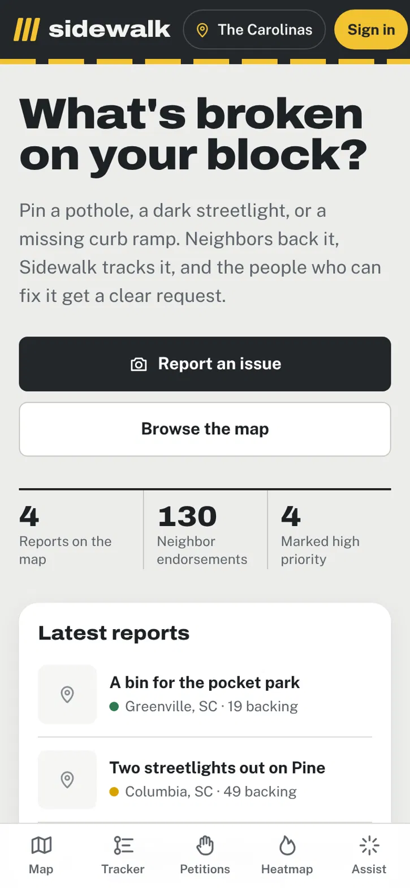
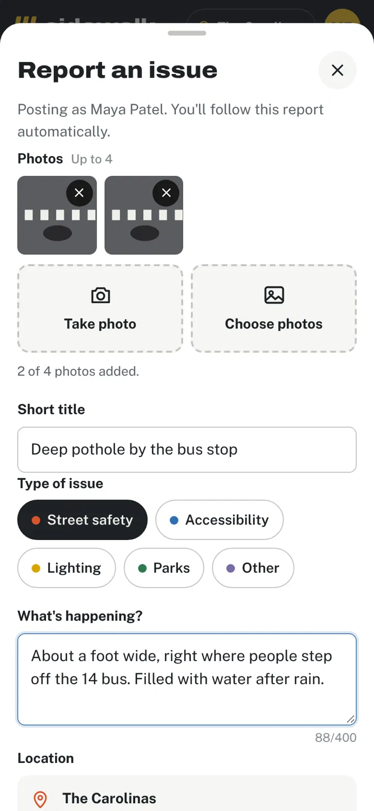
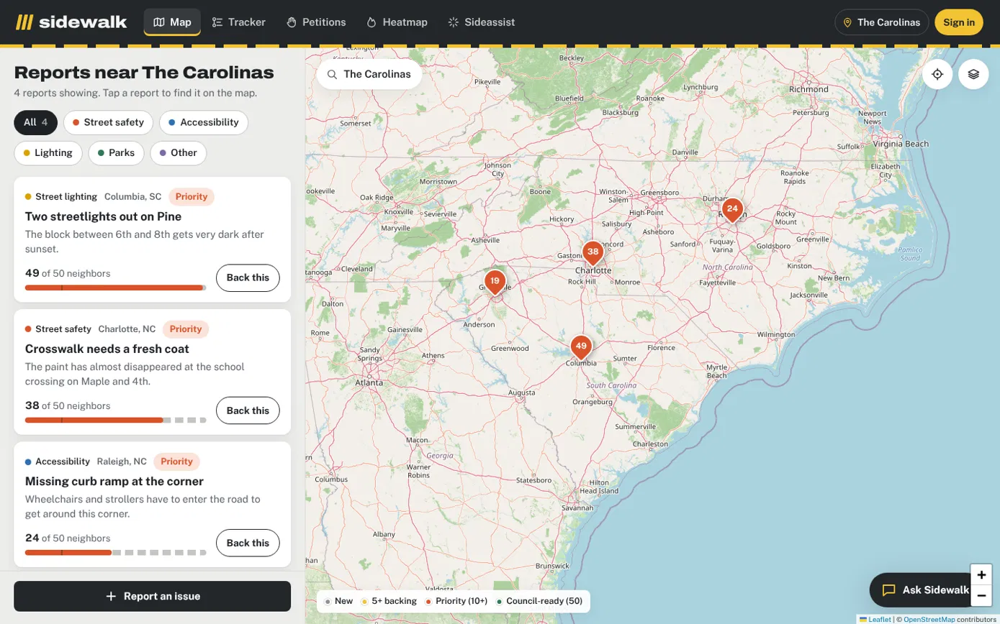

# Sidewalk

**What's broken on your block?** Sidewalk lets residents of North and South Carolina pin neighborhood infrastructure problems (potholes, dark streetlights, missing curb ramps, park issues) on a map, rally neighbors behind them, and follow each one until it's fixed.

**Live site:** https://sidewalk-production-4704.up.railway.app

<p>
  
  
</p>


---

## The problem

Small infrastructure problems are easy to notice and hard to get fixed. A pothole at a bus stop or a missing curb ramp affects everyone who passes, but reporting it usually means finding the right city department, writing a formal request alone, and never hearing back. One report from one person is easy to overlook, and neighbors who see the same problem have no way to add their voice to it.

## What Sidewalk does

1. **Report it.** Drop a pin, pick a category (street safety, accessibility, lighting, parks, other), describe the problem, and attach up to 4 photos straight from your phone's camera.
2. **Neighbors back it.** Verified residents endorse reports they care about. At **10 endorsements** a report becomes a *community priority*; at **50** it's *council-ready*, with enough support to bring to city council.
3. **Track it to "Fixed."** Every report moves through a public timeline: *Submitted → AI reviewed → Community priority → Sent to agency → In progress → Resolved*. Followers get an email at each step.
4. **Get help writing it.** *Sideassist* (Ask Sidewalk) answers questions about reporting and turns an informal complaint into a clear, respectful request to public works.
5. **See the hotspots.** A heatmap shows where reports and neighbor support are concentrated.

## Features

| Area | What's included |
|---|---|
| **Map** | Leaflet + OpenStreetMap, category filters, place search (Nominatim), color-coded pins by support level |
| **Reports** | Up to 4 photos (camera, picker, drag-and-drop, or paste), compressed on the device before upload, full-screen photo viewer |
| **Petitions** | One endorsement per verified account; thresholds at 10 (priority) and 50 (council-ready); milestone emails |
| **Tracker** | Six-stage status timeline per issue; coordinator tools to advance status (protected by an admin token) |
| **Sideassist (AI)** | Chat assistant, formal-request drafter with suggested urgency, and an automatic first review of every new report |
| **Accounts** | Email verification, resend link, forgot/reset password, 8-character minimum, unsubscribe links in every email |
| **Design** | Street-marking look (asphalt and road-paint yellow), light and dark mode, bottom tab bar and slide-up sheets on phones, top nav on desktop |

## How it works

```
Browser (public/)                Server (Node + Express)                  Services
──────────────────               ─────────────────────────                ────────────────────
index.html, style.css,   ──►     server.js   – AI routes, static files ─► Groq / OpenAI / Gemini
app.js (map, forms,              community.js – accounts, issues,      ─► Brevo (email over HTTPS)
photos, chat)                                   photos, petitions,
                                                tracker
                                 ai.js       – one interface for
                                                several AI providers
                                 SQLite (node:sqlite) – all data in
                                                one file on a volume
```

**Tech stack:** Node.js 22, Express 5, built-in `node:sqlite`, Leaflet + leaflet.heat, vanilla HTML/CSS/JavaScript (no front-end framework), Brevo for email, and Groq (Llama / GPT-OSS models) for AI, with OpenAI and Gemini supported as alternatives. Hosted on Railway with a persistent volume.

### A few pieces worth looking at

- **Photo pipeline** (`public/app.js` → `compressPhoto`). Phone photos are often 4–12 MB. The browser redraws each one on a canvas at a smaller size and lowers JPEG quality step by step until it fits, so uploads are fast on mobile data. The server then checks each file's real format from its first bytes (JPEG, PNG, or WebP signatures), not just its name, before saving it to the `issue_photos` table.
- **Endorsement thresholds** (`community.js`, `PRIORITY_THRESHOLD = 10`, `GOAL = 50`). When an endorsement pushes a report past 10, the server moves it to *community priority* automatically and records the event on its timeline. At 50, every supporter who turned on email updates gets a "goal reached" email.
- **AI provider layer** (`ai.js`). The app asks for two things, a chat reply and a structured JSON draft, through one small interface. Behind it, Groq, OpenAI, or Gemini can answer, chosen by which API key is set. If a model can't follow a strict JSON schema, the code retries in plain JSON mode with the schema written into the instructions. The AI is told never to invent addresses, laws, agency contacts, or injuries, and it labels its review as *not an on-site verification*.
- **Account security** (`community.js`). Passwords are hashed with scrypt and a random salt, compared in constant time, and sessions use random tokens in `HttpOnly`, `SameSite` cookies (`Secure` in production). Sign-up, login, and reset routes are rate-limited, and reset links expire after one hour.

## Run it locally

Requires **Node.js 22.13 or newer**.

```bash
git clone https://github.com/SiddharthTumati/Sidewalk.git
cd Sidewalk
npm install
cp .env.example .env      # on Windows: copy .env.example .env
npm start
```

Then open http://localhost:3001.

Locally you don't need any keys. Without email set up, new accounts are signed in right away and password-reset links appear on screen. Without an AI key, everything works except Sideassist.

### Environment variables

| Variable | What it's for |
|---|---|
| `GROQ_API_KEY` | Free AI key from console.groq.com (or use `OPENAI_API_KEY` / `GEMINI_API_KEY`) |
| `GROQ_MODEL` | Optional model override, e.g. `openai/gpt-oss-120b` |
| `BREVO_API_KEY` | Sends verification, reset, and update emails over HTTPS |
| `SMTP_FROM` | Sender, e.g. `Sidewalk <you@example.com>` (must be verified in Brevo) |
| `APP_URL` | Public URL of the site, used in email links |
| `ADMIN_TOKEN` | Coordinator password for moving issues along the tracker |
| `SQLITE_PATH` | Where the database file lives (`/data/sidewalk.sqlite` on Railway) |
| `NODE_ENV`, `TRUST_PROXY` | Set to `production` and `true` when deployed behind a host |

## Project structure

```
server.js        Express app, static files, Sideassist chat and drafting routes
community.js     Accounts, sessions, issues, photos, endorsements, tracker, emails
ai.js            Groq / OpenAI / Gemini behind one interface
public/
  index.html     All pages: map, tracker, petitions, heatmap, Sideassist
  style.css      Design system, light and dark themes, phone and desktop layouts
  app.js         Map, reporting flow, photo compression, sign-in, chat
docs/screenshots Images used in this README
```

## Responsible AI

Sideassist helps people *write* and *understand*. It doesn't decide anything. It never claims a report was submitted to an agency, never verifies conditions on site, and is told not to make up phone numbers, laws, or contacts. Every AI-written draft can be edited before it's used, and the chat window reminds users to confirm details with their local agency.

## What's next

- Send council-ready reports straight to city 311 systems where an open API exists
- Let city staff log in to update status themselves
- Spanish-language interface
- Neighborhood-level stats on how long fixes take

## Team

Built for the Congressional App Challenge by Akshar Katta and Siddharth Tumati.
